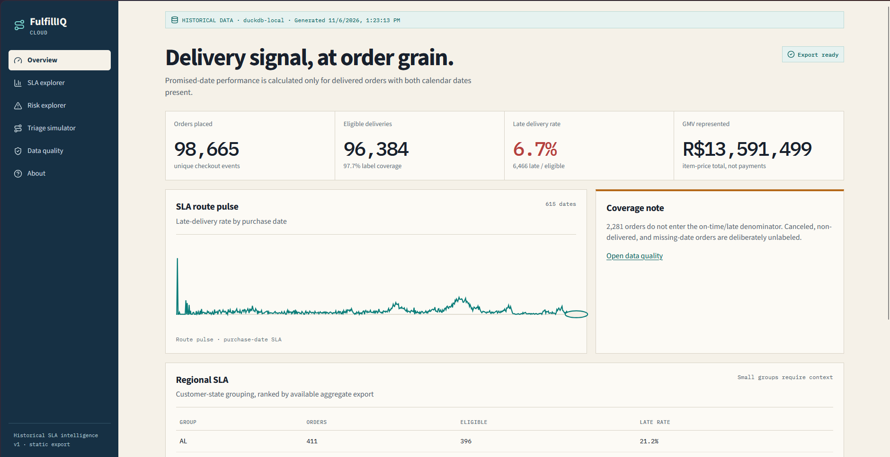
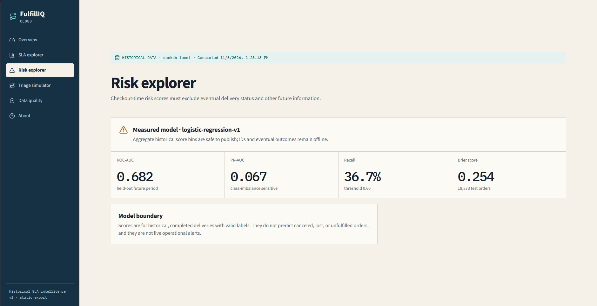
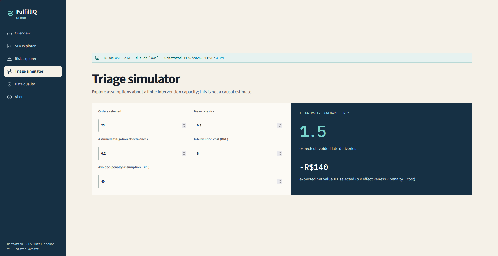
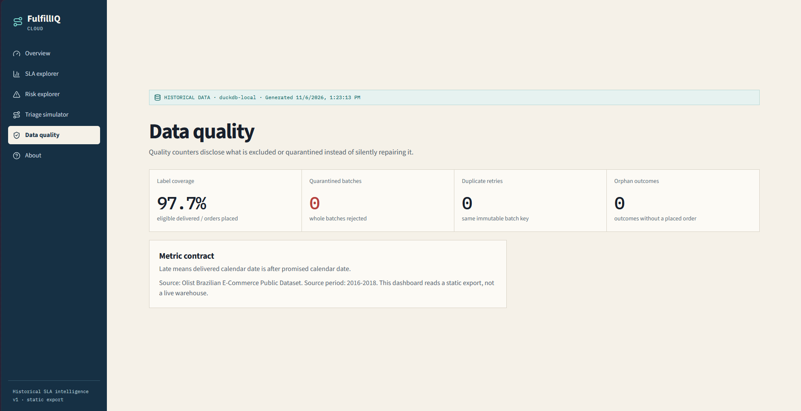

# FulfillIQ Cloud

> **What if a delivery-SLA dashboard had to earn its numbers?**

At checkout, an e-commerce customer receives a delivery promise. Operations teams need to know how often that promise is missed, which checkout-time signals are associated with risk, and whether the answer can survive a replay outside a local notebook. The difficult part is not drawing a late-rate chart; it is preserving one defensible definition from messy source files, through retries and invalid events, to a warehouse query and a browser-safe dashboard.

I built FulfillIQ Cloud as an end-to-end portfolio case study to solve that problem. It starts with local Olist marketplace CSVs, reduces multiple items to one analytical order, separates checkout facts from future outcomes to prevent leakage, and uses deterministic event batches so an at-least-once cloud pipeline can be replayed safely. The same KPI contract is then calculated locally in DuckDB and independently reconciled in AWS through private S3, Lambda, and Athena.

The result is not a simulated cloud architecture: the approved full replay reconciled **98,665 unique orders**, **96,384 eligible deliveries**, and **6,466 late deliveries**, for a **6.7086%** late-delivery rate, while retaining zero quarantined full-run batches and passing duplicate-retry checks. The sections below show how that result was designed, tested, and evidenced.

FulfillIQ Cloud is a portfolio project for historical e-commerce delivery-SLA intelligence. It turns raw Olist marketplace data into order-level events, validates and replays those events deterministically, publishes privacy-safe dashboard aggregates, and proves the same metric contract in AWS.

It is deliberately **not** a live delivery-tracking product, a current Olist service, or a system that promises causal intervention outcomes. Its purpose is to demonstrate practical data engineering, serverless processing, analytics engineering, risk modelling, and evidence-driven delivery.

## Portfolio outcome

The approved AWS replay completed in `ap-southeast-2` through `fulfilliq-workgroup` and reconciled exactly to the frozen local reference:

| Reconciled KPI | Actual cloud result |
|---|---:|
| Unique orders placed | 98,665 |
| Eligible delivered orders | 96,384 |
| Late eligible deliveries | 6,466 |
| Late-delivery rate | 6.7086% |
| Full-run curated batches | 987 placements + 964 outcomes |
| Full-run quarantine batches | 0 |

The full run passed S3-to-Lambda processing, Athena DDL and SQL checks, duplicate retry probes, scoped-prefix isolation, and a final Terraform no-drift plan. The exact Athena query IDs and scan bytes are in [cloud query evidence](docs/evidence/cloud-queries.md).

## Why this project exists

Operations teams need a trustworthy view of whether orders met the customer promise, what checkout-time factors correlate with risk, and which data quality conditions limit conclusions. A dashboard alone is not enough: delivery analytics needs a defensible denominator, replay-safe ingestion, explicit data lineage, and evidence that the cloud path agrees with local calculations.

FulfillIQ addresses that by:

- Establishing **one order as one analytical row** across preparation, replay, warehouse queries, model features, and dashboard exports.
- Separating checkout-time facts from future delivery outcomes to prevent label leakage.
- Treating S3 delivery as at-least-once and making retries safe through content-addressed batches and immutable curated output checks.
- Keeping raw customer/order data and credentials out of the browser.
- Recording actual cloud results rather than presenting simulated cloud success.

## Architecture

```text
Local Olist CSVs
  │
  ├─ validate source tables and foreign-key relationships
  ├─ aggregate order items to one order
  ├─ emit checkout-only order_placed and later delivery_outcome JSONL events
  └─ create canonical, content-addressed batches
       │
       ├─ Local: validate → quarantine invalid whole batches → DuckDB → JSON aggregates → Vite dashboard
       │
       └─ AWS: private S3 raw prefix → Lambda validation/normalisation → curated S3 prefixes
                  → Athena external tables and reconciliation queries
```

The local and cloud paths share the same event contract and transformation behaviour. Cloud runs are isolated by a run ID, for example `olist-2018-08-31-full`, so synthetic smoke records and smaller-stage records cannot enter the full KPI tables.

## What the implementation demonstrates

| Area | Implementation |
|---|---|
| Data engineering | Source validation, deterministic item-to-order aggregation, explicit lineage, JSONL contracts, and data-quality exports. |
| Event processing | Canonical JSONL, 100-record/256 KiB batches, content-derived batch IDs, whole-batch validation, and quarantine reports. |
| Idempotency | S3 retry-safe curated keys; Lambda reads an existing curated object and accepts only byte-identical retries. Differing content at the same key is quarantined. |
| Cloud engineering | Terraform-managed private S3, TLS-deny policy, SSE-S3, Lambda, scoped IAM, CloudWatch logs, S3 notifications, and Athena workgroup scan limit. |
| Analytics | DuckDB local semantic layer plus Athena external-table reconciliation using the same order-level KPI definitions. |
| ML | Leakage-aware logistic-regression baseline with chronological split and aggregate-only risk export. |
| Frontend | React + TypeScript + Vite dashboard with responsive navigation, semantic UI, keyboard-visible focus, and aggregate-only static JSON. |
| Quality assurance | Contract, unit, integration, ML, frontend, Terraform, smoke, retry, quarantine, and cloud reconciliation checks. |

## Metric contract

The KPI definition is intentionally precise:

```text
eligible_delivery = delivered status AND delivered date present AND promised date present
delivery_late    = eligible_delivery AND delivered calendar date > promised calendar date
late_delivery_rate = late_delivered_orders / eligible_delivered_orders
```

Canceled, non-delivered, and missing-date orders are **not** labelled on time; they are excluded from the late-rate denominator. Dates are compared as calendar dates, not as timestamps coerced to midnight. GMV is the order-level sum of item prices, not payment total, revenue, margin, or profit. See the full [metric contract](docs/metrics.md) and [data dictionary](docs/data-dictionary.md).

## Data model and leakage control

Preparation emits two separate event types:

| Event | Contains | Does not contain |
|---|---|---|
| `order_placed` | Checkout timestamp, promised date, customer/seller geography, item and seller counts, item-price total, freight, and primary category | Delivery date, terminal status, review, carrier handoff, or any future outcome |
| `delivery_outcome` | Delivered date and final delivered status | Features that would modify the original checkout-time event |

The model uses only information that would have existed at checkout: calendar features, promised lead time, location/seller grouping, item/seller counts, price/freight totals, and initial category. It excludes outcome fields, reviews, carrier handoff, approval timestamp, future aggregates, and target encoding. Its chronological held-out evaluation recorded ROC-AUC 0.6815, PR-AUC 0.0671, Brier score 0.2543, precision 0.0570, recall 0.3670, and F1 0.0986 at a validation-selected 0.60 threshold. These are historical baseline metrics, not a production-quality or causal claim. See the [model card](docs/ml-model-card.md) and [training report](docs/evidence/ml-training-report.md).

## Dashboard

The static React dashboard provides:

- Overview metrics: orders, eligible deliveries, late rate, GMV, and label coverage.
- Purchase-date SLA trend and regional/category breakdowns.
- Data-quality view for label coverage, quarantine, duplicates, and orphan outcomes.
- Aggregate risk-bin summary and an explicitly assumption-based triage simulator.
- An about page that identifies the historical data source and export mode.

The browser receives aggregates only: no raw order IDs, customer records, AWS credentials, or raw scores. Public JSON is strict JSON; non-finite dataframe values are exported as `null`, never `NaN` or `Infinity`.

### Dashboard gallery

The screenshots below were captured from the local static export built from the full, reconciled Olist workflow. They show the dashboard's main decision surfaces and the limits stated alongside each result.



*Overview: the order-level KPI contract, purchase-date SLA trend, and regional context in one view.*



*Risk explorer: aggregate model quality metrics and an explicit boundary on what the historical score can represent.*



*Triage simulator: a transparent, assumption-based scenario for prioritising a finite intervention capacity. It is not a causal estimate.*



*Data quality: label coverage and full-run exception counters, making exclusions and pipeline outcomes visible.*

Start the dashboard after generating its data:

```powershell
cd "D:\My Life\Projects\fulfilliq-cloud\web"
npm run dev
```

`npm run build` produces a static bundle in `web/dist`. Public hosting is intentionally outside this repository's deployed scope.

## Local quick start with synthetic data

Prerequisites: Python 3.12 and Node.js 20+.

```powershell
python -m pip install -r requirements-dev.txt
cd web; npm install; cd ..

python scripts/generate_synthetic_fixtures.py --output data/synthetic
python -m fulfilliq.cli prepare --source data/synthetic --output data/prepared/synthetic
python -m fulfilliq.cli replay --input data/prepared/synthetic --output data/batches/synthetic
python -m fulfilliq.cli local-ingest --input data/batches/synthetic --output data/local-curated/synthetic
python -m fulfilliq.cli local-query --input data/local-curated/synthetic --output data/exports/synthetic --mode synthetic
python -m fulfilliq.cli build-dashboard-data --input data/exports/synthetic --output web/public/data --mode synthetic

cd web
npm run dev
```

## Reproducing the local Olist workflow

Owner-supplied Olist CSVs belong in `data/source/`; they are intentionally ignored by Git. The `--as-of 2018-08-31` cutoff reproduces the frozen portfolio scope.

```powershell
python -m fulfilliq.cli validate-source --source data/source
python -m fulfilliq.cli prepare --source data/source --output data/prepared/olist
python -m fulfilliq.cli replay --input data/prepared/olist --output data/batches/olist --as-of 2018-08-31 --max-records 100
python -m fulfilliq.cli local-ingest --input data/batches/olist --output data/local-curated/olist
python -m fulfilliq.cli local-query --input data/local-curated/olist --output data/exports/olist
python -m fulfilliq.cli train --input data/prepared/olist --output artifacts/model/olist
python -m fulfilliq.cli score --model artifacts/model/olist --input data/prepared/olist --output data/exports/olist
python -m fulfilliq.cli build-dashboard-data --input data/exports/olist --output web/public/data --mode local
```

If the dashboard was already running, refresh it after rebuilding the export. The exporter guarantees browser-parseable JSON by converting undefined numeric values to `null`.

## AWS implementation and reconciliation

The deployed AWS footprint is intentionally small:

- Private S3 bucket with all public-access blocks enabled, default SSE-S3 encryption, and a policy that denies non-TLS traffic.
- Python 3.12 Lambda with 256 MB memory, a 30-second timeout, CloudWatch logs retained for seven days, and prefix-scoped least-privilege IAM.
- S3 `ObjectCreated` notification for raw JSONL batches.
- Athena workgroup configured with an enforced result location and a 100 MiB per-query scan cutoff.

The rollout was evidence-gated: synthetic smoke, 100-order stage, 1,000-order stage, then the full 98,665-order replay. Each stage used its own raw/curated/quarantine prefix and Athena tables. Full reconciliation used 987 placement and 964 outcome batches, produced no quarantine objects, and passed an exact retry probe for one batch of each event type.

The three full KPI queries scanned 116,627,908 bytes in total; no individual query exceeded the workgroup cap. The billing-console balance was not captured, so the repository makes no zero-cost claim. See [cloud deployment evidence](docs/evidence/cloud-deployment.md), [query evidence](docs/evidence/cloud-queries.md), [failure recovery evidence](docs/evidence/cloud-failure-recovery.md), and [cost evidence](docs/evidence/cost-checks.md).

For a future replay or cleanup, follow the scoped [staged rollout runbook](docs/runbooks/staged-olist-rollout.md) and [teardown runbook](docs/runbooks/teardown.md). Do not broadly delete a bucket, workgroup, smoke evidence, or Athena results.

## Validation and developer checks

Run the Python checks:

```powershell
python -m pytest tests/unit tests/contract tests/integration tests/ml
python -m ruff check src tests lambda
```

Run the frontend checks:

```powershell
cd web
npm run lint
npm run test
npm run build
```

The project also includes a CI configuration, Terraform static validation, deployment/recovery evidence, and detailed implementation log. CI workflow execution in a remote Git host is not claimed by this repository unless independently recorded.

## Repository map

```text
src/fulfilliq/       Python CLI, contracts, preparation, replay, local analytics, AWS helpers, ML
lambda/              Lambda adapter and deployment requirements
infra/terraform/     S3, IAM, Lambda, CloudWatch, notification, and Athena workgroup IaC
web/                 React/TypeScript/Vite static dashboard
tests/               Unit, contract, integration, and ML tests
data/source/         Local-only Olist CSV input (ignored)
data/prepared/       Local prepared events and manifests (ignored)
data/batches/        Content-addressed replay batches (ignored)
data/exports/        Local dashboard and analytics exports (ignored)
docs/                Architecture, decisions, evidence, model card, and operational runbooks
```

## Scope, privacy, and limitations

- Olist is a historical Brazilian dataset from 2016–2018, not a current feed and not evidence about Indonesian delivery performance.
- The dashboard describes historical patterns; it does not provide live tracking, operational alerts, or causal ROI predictions.
- The completed-delivery model is subject to selection bias and does not predict canceled or lost orders.
- S3/Lambda processing is retry-safe and idempotent at the curated-object level, but this is not a claim of globally exactly-once event delivery.
- Raw CSVs, credentials, Terraform state, model binaries, and order-level exports are excluded from Git and the browser.
- The implemented dashboard is the React static application in `web/`.

## Documentation and evidence

- [Product brief](PRODUCT.md)
- [Architecture](docs/architecture.md) and [data lineage](docs/data-lineage.md)
- [Metric contract](docs/metrics.md), [data dictionary](docs/data-dictionary.md), and [limitations](docs/limitations.md)
- [Model card](docs/ml-model-card.md)
- [Full cloud query evidence](docs/evidence/cloud-queries.md)
- [Final verification](docs/evidence/final-verification.md)
- [Dashboard smoke evidence](docs/evidence/dashboard-smoke.md)
- [Staged rollout and recovery](docs/runbooks/staged-olist-rollout.md)
- [Security posture](docs/security.md) and [cost controls](docs/costs.md)

## License and attribution

The Olist Brazilian E-Commerce Public Dataset is licensed under CC BY-NC-SA 4.0. Review [DATA_LICENSE.md](DATA_LICENSE.md) before redistributing data or derived assets. Source data is not included in this repository.
